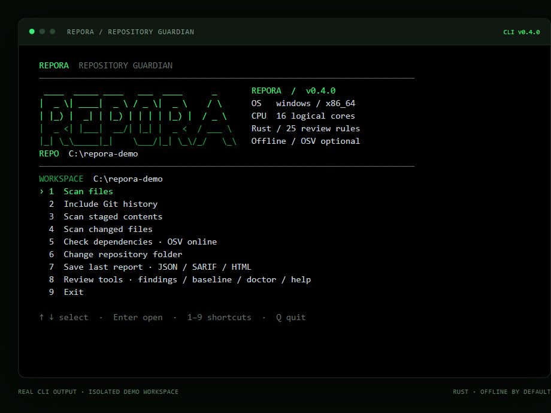

<div align="center">

# REPORA

### Repository Guardian

**Review what vibe coding leaves behind.**

A small Rust CLI for exposed secrets, sensitive files, risky configuration and locked dependencies.<br>
English interface. Green-on-black terminal. Offline by default.

[](https://github.com/dRafaleD/repora/actions/workflows/check.yml)


[](LICENSE)

[Quick start](#quick-start) · [Features](#features) · [Commands](#commands) · [Reference](docs/REFERENCE.md)



<sub>Captured from real REPORA CLI output on Windows, rendered as a terminal preview in an isolated demo workspace.</sub>

</div>

## Why REPORA?

Fast prototyping can leave hardcoded credentials, local `.env` files and unsafe defaults behind. REPORA gives you a small, explainable review step before you commit or share a repository.

It reads source text and local Git data, keeps detected values out of its output, and shows where each pattern was found. Findings are review signals; they do not establish credential validity or exploitability.

## Quick start

Install [Rust and Cargo](https://www.rust-lang.org/tools/install), then build from source:

```sh
git clone https://github.com/dRafaleD/repora.git
cd repora
cargo install --path . --locked --bin repora
```

Ensure Cargo's `bin` directory is on `PATH`: normally `%USERPROFILE%\.cargo\bin` on Windows or `$HOME/.cargo/bin` on Linux/macOS.

```sh
# Open the interactive workspace in your current directory.
repora

# Scan a repository directly.
repora scan /path/to/project
repora scan /path/to/project --fail-on-findings
```

For Windows paths:

```powershell
repora ui "C:\projects\my-app"
repora scan "C:\projects\my-app" --json
```

Use **↑ / ↓** and **Enter**, or **1–9**, in the workspace. **Q**, **Esc** or **Ctrl+C** exits. ASCII startup, animation and a system card are built in; no neofetch installation is required. The interface is in English.

## Features

| Area | What you can review |
|---|---|
| Secrets | Private-key headers, selected provider token formats, hardcoded passwords/API secrets and credential-bearing URLs |
| Sensitive files | `.env`, selected credential files, key stores and Terraform state |
| Configuration | Debug, wildcard CORS, disabled TLS, unsafe containers and selected workflow/cookie/auth signals |
| Git | Working tree, changed files, staged **index contents**, and bounded local history |
| Dependencies | Offline locked-package inventory; optional OSV advisory checks |
| Review | Interactive explorer with search, priority, rule, filename and new-finding filters |
| Baselines | Compare redacted-context fingerprints and focus on new findings |
| Reports | Text, JSON, SARIF 2.1.0 and standalone searchable HTML |
| Policy | TOML exclusions, justified expiring exceptions and custom regex rules |
| Diagnostics | Local installation, PATH, configuration, Git and Cargo checks |

## Commands

```sh
# Current text files, including ignored local files such as .env.
repora scan .

# What is actually staged for your next commit.
repora scan . --staged --fail-on-findings

# Whole changed files since a reference, plus non-ignored new files.
repora scan . --changed HEAD

# Working tree plus available local history.
repora scan . --history --max-commits 100
repora scan . --history --all-refs --max-commits 100

# Offline package inventory, or explicit online OSV queries.
repora scan . --inventory --json
repora scan . --dependencies --json

# Save reports; existing files are never overwritten.
repora scan . --json --output report.json
repora scan . --format sarif --output report.sarif
repora scan . --format html --output report.html

# Open or filter an existing JSON report.
repora review report.json
repora review report.json --severity high --json

# Local diagnostics and full command help.
repora doctor
repora scan --help
```

`--history`, `--changed` and `--staged` are mutually exclusive. Git-aware modes need Git; changed-file mode needs a valid comparison reference. History never fetches and excludes remote refs, reflogs and unreachable objects.

### Track new findings

```sh
repora scan . --save-baseline repora-baseline.json
repora scan . --baseline repora-baseline.json --only-new --fail-on-findings
```

Only complete, unfiltered scans can create baselines. They are bound to the same canonical scan root, tool version, modes and configuration policy. Baselines store scope metadata and fingerprints, not detected values. Keep local baselines out of public repositories.

### Configure your scan

REPORA loads `guvenlikbakici.toml` from the scan root. The legacy filename is retained for compatibility; use `--config` to select another file.

```toml
exclude = ["reports/**", "docs/assets/**"]
disabled_rules = []

[[exceptions]]
rule = "hardcoded-secret"
path = "tests/fixtures/**"
reason = "Synthetic regression fixtures only."
expires = "2026-12-31"
```

Paths use `/` separators and are relative to the scan root. Exceptions require a reason; expiry is inclusive through the specified UTC day. Suppressed findings remain visible in JSON. Prefer narrow exceptions over globally disabling rules.

The [reference](docs/REFERENCE.md) covers custom rules, fingerprint behavior, dependency parsing, report metadata and local-source updates.

## Dependencies and privacy

Scanning is **offline by default**. Inventory supports selected Cargo, npm, pnpm, Yarn, uv, Poetry, exact-pinned requirements and Go checksum formats. Unsupported formats or sources are reported as incomplete coverage.

`--dependencies` explicitly enables [OSV querybatch](https://google.github.io/osv.dev/post-v1-querybatch/). It sends selected package/module names, ecosystems and exact versions. Source code, paths and detected values are not sent. Go module names and some lockfile entries are assumed public; review sensitive package metadata before opting in.

Reports omit detected credential values and source excerpts. Paths, package metadata, custom descriptions and exception reasons can still appear. Do not place credentials in those fields, and review reports before sharing them.

## Coverage and exit codes

REPORA performs bounded text-pattern analysis. It does not execute scan-target code, install target dependencies, follow symlinks, extract archives, analyze binaries or trace application data flow and authorization. Git hooks and external diff/textconv helpers are disabled for scanning.

Default excluded directories: `.git`, `.repora`, `node_modules`, `target`, `vendor`, `.venv`, `venv`, `dist`, `build`. Submodules need separate scans. Normal scans do **not** inherit `.gitignore`.

| Bound | Limit |
|---|---|
| File size | 4 MiB |
| Total bytes read | Approximately 128 MiB; up to one file of overshoot |
| Working-tree / cumulative history entries | 100,000 each |
| Directory depth | 64 |
| Findings and suppressions | 10,000 combined |
| History commits | 100 by default; up to 1,000 |
| Git subprocess | 20 seconds, with bounded output |
| Detailed skip records | First 1,000; total count preserved |

Binary/non-UTF-8 files, oversized files, read errors and reached limits mark a scan **incomplete**. Images can therefore cause code `2`; inspect coverage before treating it as a tool failure. Exclusions define a narrower reviewed scope. `complete: true` means that scope completed, not that a repository is secure. Avoid changing targets during a scan; scans are not atomic snapshots.

| Exit | Meaning |
|---|---|
| `0` | Scan completed; findings are allowed unless `--fail-on-findings` is set |
| `1` | Complete scan with unsuppressed findings and `--fail-on-findings` |
| `2` | Startup/configuration error or incomplete scan; takes precedence over findings |

## Pre-commit and CI

Copy [.githooks/pre-commit](.githooks/pre-commit) into the target repository and configure it there:

```sh
git config core.hooksPath .githooks
# Linux/macOS:
chmod +x .githooks/pre-commit
```

Merge with existing hooks. The hook checks index contents and blocks on findings, incomplete scans or a missing REPORA installation. Local hooks are bypassable; pair them with CI.

The [GitHub Actions workflow](.github/workflows/check.yml) runs formatting, tests, Clippy and a repository scan on Windows and Ubuntu. Actions are pinned to commits. SARIF is retained as an artifact; automatic Code Scanning upload is not configured.

## Development

```sh
cargo fmt --check
cargo test --locked
cargo clippy --locked --all-targets -- -D warnings
cargo build --release --locked
```

The suite has 39 distinct tests with synthetic values and temporary Git repositories; unit tests run through both binary entry points. A local Windows stability exercise covered 25 project folders and 136 CLI invocations with no observed crashes or timeouts, and identical repeated working-tree reports. Coverage was incomplete in 15 folders. This does not establish detection accuracy or platform-wide guarantees; private target reports are not distributed.

The `guvenlikbakici` source binary is retained for compatibility. `repora update --source /path/to/repora` supports explicit local-source updates on Windows and builds that trusted source. No remote update feed or prebuilt release installer is configured.

## License

[MIT](LICENSE). Contributions and focused bug reports are welcome. Share minimal synthetic reproductions and coverage metadata; keep real credentials and private reports out of public issues.
